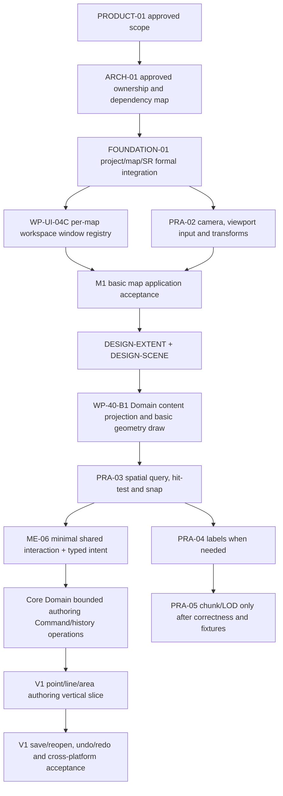

# ARCH-01 — Cross-Domain Dependency & Architecture Reconciliation

- Version: 0.1
- Date: 2026-11-27
- Status: Architecture audit and recommendation baseline — submitted for review
- Repository: `luqizheng/worldview`
- Audited baseline: `master` / PR #45 merge `edb978ee12e8401a92eb5108b91b33224e3a23b5`
- Product authority: [PRODUCT-01 V1 Scope & E2E Acceptance](../product/PRODUCT-01-v1-scope-and-acceptance.md)
- Planning authority: repository-root `plan.md`

## 1. Executive disposition

PRODUCT-01 is a valid and achievable product boundary, but the current repository does **not** yet implement M1 end-to-end and is materially short of the V1 manual-authoring loop.

The repository has substantial reusable foundations:
- local project package creation/open/close, SQLite Core Domain persistence and Asset Store ownership;
- formal Project/Map/History/Calendar creation and Map query/context resolution;
- Object identity, descriptor validation, reservation, definition, Map registration and time-zero Initial State primitives;
- immutable presentation-context/snapshot publication and careful viewport/resource lifecycle handling.

Those foundations must not be mistaken for complete product capabilities. The decisive gaps are:
1. Map Workspace is still hosted inside the Project Window; the approved one-independent-window-per-map behavior and window registry are not implemented.
2. The current scene model and renderer intentionally support only a blank background. No authoritative Map content is projected into renderable point/line/polygon scene items.
3. The viewport control has no completed pan/zoom/reset interaction and coordinate-transform path.
4. Core Domain currently has no persisted Command/Event/State Change execution/replay path or formal Relationship persistence. Existing object/definition/Initial State transactions are not a substitute for historical editing.
5. Generic manual geometry authoring has no complete Application → Domain → Asset publication/read → Presentation path. Existing geometry primitives and Building/Cave asset publication do not prove a general point/line/polygon editor.
6. New Maps are created without a Spatial Reference binding; immutable Spatial Reference registration/binding primitives exist, but no project default/creation workflow establishes one.
7. Layer visibility/order and a persisted or transient user-facing layer/content navigator are not connected to the real Map content pipeline.

**Recommendation:** keep the approved sequential work-package order. Complete ARCH-01 review, then use FOUNDATION-01 to close only the formal Project/Map/Spatial Reference/Application integration blockers. Deliver M1 through a vertical slice that includes the real independent Map Workspace window and a functioning viewport. Only then implement the smallest V1 manual authoring slice, with Core Domain-owned formal operations and history. Do not start PRA-05 optimization.

## 2. Scope and evidence method

This is a source-and-contract reconciliation at the audited merge SHA above. It inspects the actual production source and relevant accepted/working contracts, including:
- PRODUCT-01 and root `plan.md`;
- Core Domain CD-02 reports, `ICoreDomainDatabase`, Object/Geometry/Map services and SQLite adapters;
- Application use cases, session lifecycle and query/creation ports;
- Desktop composition root, Project Window, workspace ViewModel and viewport host;
- Presentation `SceneAssembler`, `SceneItem`, `SceneLayer` and `MapSceneRenderer`;
- ME-01-05, ME-06-D/ME-06 shared interaction contracts, ME-05-06, ME-06-G, PRA-01 and WP-UI-04 contracts.

This is not a claim that a local GUI acceptance run was performed. GitHub CI for PR #45 passed Windows/macOS Debug/Release; that proves the configured automated build/test matrix, not the manual GUI acceptance scenarios.

Evidence labels:
- **Implemented** — production source path exists; this does not imply every product-level integration/acceptance condition passes.
- **Partial** — reusable primitives exist, but the required end-to-end path or acceptance evidence is missing.
- **Design only** — contract exists but no production implementation was found at this baseline.
- **Missing** — no authoritative production operation/path was found.

## 3. Ownership decisions reconciled

The following ownership boundaries are consistent across the current Core Domain, ME-01, ME-05, ME-06 and PRA contracts and should be retained:

| Concern | Sole authority / owner | Consumers | Explicitly not owned by |
|---|---|---|---|
| Project, Map, History, Branch, Calendar identity and lifecycle | Core Domain | Application, Desktop | ViewModel, renderer |
| Object Type, Object identity, reservation, definition and lifecycle | Core Domain | Application, Editor | Tool catalog, scene item |
| Formal geometry-component identity, role and membership | Core Domain typed owner payload | Map Engine, Presentation | renderer buffer/index |
| Immutable geometry/field bytes | Asset Store; formal adoption by owning Domain operation | Map Engine, Presentation | mutable editor preview |
| Initial State and future historical Commands/State Changes | Core Domain | Application | Editor-local undo stack |
| Spatial transforms, predicates, index, hit-test and snap | Map Engine / spatial services | Editor, Presentation | Core Domain facts |
| Gesture, selection, preview, active tool and local transient state | Shared Editor Interaction Runtime | Desktop tools | Core Domain |
| Immutable scene snapshot, style interpretation and rendering | Presentation / Renderer | Desktop viewport | Domain persistence |
| Window and native control lifetime | Desktop | Application sessions via explicit lifecycle calls | Core Domain |

Do not add a second Object registry, renderer-owned semantic graph, UI-direct persistence, generic CRUD escape hatch, generalized event bus, distributed scheduler or multi-user locking model. Runtime async correctness remains mandatory: cancellation, stale-result rejection, UI-thread affinity and deterministic disposal.

## 4. PRODUCT-01 E2E capability mapping

| E2E | Required outcome | Current owning path | Status at audited baseline | Blocking gap |
|---|---|---|---|---|
| E2E-01 | Create/reopen local Project | `CreateProjectUseCase`, `OpenProjectUseCase`, `ProjectSession`, package DB and Core Domain adapters | **Partial / strong foundation** | Automated paths exist and are wired in `Program.cs`; clean Windows/macOS GUI round-trip evidence remains required. |
| E2E-02 | Create/open Map in its own window; repeated open activates existing window | `CreateMapUseCase`, `CoreDomainMapCreationService`, `ProjectSession.OpenWorkspaceAsync`, Desktop window host | **Partial** | Map create/query/context resolution and session-level same-map reuse exist. Current UI hosts selected workspace inside one `ProjectWindow`; no per-map `MapWorkspaceWindow` or registry. |
| E2E-03 | Pan/zoom/reset a real viewport | `WorkspaceViewState`, `MapViewportControl`, PRA-02 | **Partial / not accepted** | Viewport and rendering lifecycle exist, but no complete camera transform/input behavior or cross-platform GUI proof. |
| E2E-04 | Create and inspect supported point/line/area content | Core Domain Object/Geometry + Application authoring use cases + Asset Store + Scene projection | **Missing end-to-end** | Object/geometry validation primitives exist, but no general manual authoring use case, typed operation routing, content read projection or geometry renderer. |
| E2E-05 | Edit/delete content | Core Domain formal operation/history + Application + Editor | **Missing for editor semantics** | Definition/Initial State CAS and unregister primitives are not a complete edit/delete/history model. No formal Command execution/replay/undo-redo path. |
| E2E-06 | Organize content and layers | Core Domain semantic content; Presentation scene layers; Editor transient visibility/order state | **Missing end-to-end** | Current scene layer is only a generic immutable presentation container; current assembled scene contains only the background. No real content-layer projection or layer UI state is wired. |
| E2E-07 | Save/close/reopen same formal Map content | Project package + Core Domain + Asset Store + Application lifecycle | **Partial** | Project and Map structural persistence exist. The supported manual geometry authoring path whose content must round-trip does not yet exist. |
| E2E-08 | Cancel/reject/failure recovery | Application result contracts, Domain transactions, Asset publication and session cancellation | **Partial** | Strong atomicity/fail-closed primitives exist. Editor preview/cancel/apply/reconcile and authoring failure UX are not implemented. |
| E2E-09 | Windows/macOS lifecycle and behavior | CI matrix + platform GUI acceptance | **Partial** | PR #45 CI passed four platform/configuration jobs. Manual GUI, window behavior, input/DPI and repeated open/close acceptance remain open. |

### 4.1 Corrected implementation facts

Some older source comments and design reports are stale relative to current source:
- `IMapQueryService.cs` still says its implementation is absent, but `Program.cs` constructs `CoreDomainMapQueryService` for each Project Session and `CoreDomainAdapters.cs` implements list/get.
- The same composition root wires `CoreDomainWorkspaceContextResolver` and `CoreDomainMapCreationService`.
- Project creation is wired through `CoreDomainProjectCreationService`; `CreateProjectUseCase` is not currently blocked by a missing production adapter.
- `ProjectWorkspaceViewModel` and `MapWorkspaceSession` contain substantial cancellation, close, stale-result and lifecycle protections. These are useful foundations, not evidence of a separate Map Workspace window.

Update stale comments/reports when their owning files are next changed; do not let stale comments override executable source.

## 5. Formal data and write-path findings

### 5.1 Project and Map

**Implemented**
- Project identity and built-in Object Type seeding are created through a Core Domain transaction.
- Map creation writes Map + root History + default Calendar + day-zero Calendar Configuration as one structural transaction.
- Project-scoped Map list/get and Map/Branch/history-time context resolution are wired in the Desktop composition root.

**Blocking issue**
- `MapRules.CreateMap` currently sets `SpatialReferenceId = null`.
- Immutable project-scoped Spatial Reference definitions and one-time Map binding are implemented in Domain/Infrastructure, but no default Spatial Reference is created/selected as part of Project or Map setup.

**Recommendation**
- FOUNDATION-01 must decide and implement one explicit local-project default Spatial Reference profile and bind each newly created Map before geometry authoring is enabled. The definition must be immutable and project-scoped; a Map's reference must not be silently changed after geometry exists. Do not infer a CRS from viewport pixels.

### 5.2 Object and Initial State

**Implemented**
- Object identity allocation/reservation/binding, descriptor pinning and formal insertion.
- Map registration and time-zero Initial State membership.
- Definition CAS editing and Initial State CAS full-set replacement.
- Atomic transactions and real SQLite failure/rollback tests for the operations that exist.

**Limit**
- These primitives do not amount to a complete editor command model. Definition CAS edits the current definition; Initial State CAS replaces a baseline set. Neither records a user-intended historical Command or supports deterministic undo/redo by itself.
- Unregistering a Map Object is not equivalent to a formal historical deletion operation.

### 5.3 Command, Event, State Change, History and Relationship

**Missing at this baseline**
- CD-02 final report explicitly defers Command/Event write paths to CD-03+ and Relationship persistence to a later phase.
- `ICoreDomainDatabase` exposes Project/Map/Branch, Object, Definition, registration, Initial State, Asset, Field and Spatial Reference operations, but no persisted Command/Event/State Change execution or replay API and no Relationship persistence API.
- The production source tree has no corresponding Command/History execution service for editor operations.

**Architecture consequence**
- Do not implement editor Undo/Redo by reversing ViewModel state or by maintaining a second editor history. The formal command/history owner must be Core Domain.
- FOUNDATION-01 must not quietly expand into a full generic command framework unless the V1 operations require it. ARCH-01 recommends a bounded first command slice for the exact supported authoring operations, including deterministic replay/reconstruction, atomicity, idempotent retry and explicit undo/redo semantics.
- Relationship persistence is not a blocker for a deliberately relationship-free first point/line/polygon authoring slice. It becomes a blocker before any V1 operation claims formal road connectivity, containment, access or other semantic relationships. Keep those specialist capabilities deferred.

### 5.4 Geometry and Asset

**Implemented**
- Geometry component manifests, stable component identity rules, descriptor role/family/dimension checks and a bounded `worldview.geometry-json` envelope validator.
- Immutable content-addressed Asset storage and integrity verification.
- Atomic Object Definition + complete Geometry Asset-link publication for the implemented Building/Cave adoption path.

**Missing / partial**
- No general Application authoring use case was found that takes a manual point/line/polygon gesture through typed intent, validates it, publishes immutable geometry bytes, formally adopts the component, and returns an authoritative result.
- No complete generic geometry component add/adjust/refine/remove command path is exposed to the editor.
- Geometry envelope validation is structural; it does not replace the missing Map Engine precision, projection, topology and spatial operation services.

**Recommendation**
- Reuse the Asset Store and manifest model. Do not create a second geometry persistence system or store mutable geometry in renderer/UI state.
- Implement only the geometry families and semantic Object Types explicitly approved for the first V1 slice. Keep unsupported geometry and split/merge fail-closed.

## 6. Presentation, viewport and window findings

### 6.1 Presentation snapshot

**Implemented**
- Separate `WorldView.Presentation` assembly with immutable Presentation Context, request coordination, generation tracking, scene snapshot publication and stale/closed lifecycle protections.
- Desktop composition and viewport binding consume a captured immutable snapshot.

**Current capability boundary**
- `SceneAssembler` is explicitly a blank-scene assembler.
- `SceneItem` currently has only `BlankBackgroundItem`.
- `MapSceneRenderer.Draw` clears/draws the background and intentionally draws no Map geometry.
- The scene pipeline does not currently read Core Domain map content or project formal geometry into scene items.

**Consequence**
- PRA-01 is implemented as snapshot/publication infrastructure, not as a complete content renderer. M1 still needs a genuine viewport interaction path; V1 needs a formal Domain read → scene projection → visible geometry path.

### 6.2 Camera and spatial services

- `MapViewportControl` currently owns layout, focus, DPI/size observation and lifecycle forwarding; the source does not establish complete pan/zoom/reset interaction.
- PRA-03 coordinate transforms, spatial index, deterministic hit testing and snapping remain unimplemented as a complete service.
- Keep camera/view state separate from Map Space and immutable Spatial Reference definitions. Never store screen coordinates as formal geometry.
- PRA-05 remains blocked by the existing plan gates. Chunk/LOD is derived presentation optimization and cannot compensate for missing geometry semantics or an empty scene.

### 6.3 Map Workspace windows

- `MapWorkspaceSession` and ProjectSession same-map session reuse exist.
- Current Desktop UI keeps a single `ProjectWindow`, with a selected workspace/viewport host; it does not implement the WP-UI-04 target of one independent window per Map Workspace.
- WP-UI-04 README/architecture/window-management describe the intended light registry + per-map window approach; WP-UI-04C window layer remains unimplemented.
- The approved PRODUCT-01 E2E-02 behavior therefore remains open. Implement a small Desktop registry keyed by `(ProjectId, MapId)`; keep Application Session as the sole owner of MapWorkspaceSession lifetime. Do not introduce a general MDI/window framework.

## 7. Runtime stack and platform baseline

- Current source uses .NET 11 and Avalonia 12.1.6; the renderer project and SkiaSharp integration are present in the post-PR-40 source baseline.
- PR #45 CI run `45982293910` completed successfully on macOS Debug/Release and Windows Debug/Release. This is automated build/test evidence only.
- Keep Windows and macOS as independent acceptance targets. Run GUI checks for project creation/open/close, Map Workspace window creation/activation, pan/zoom, high-DPI/input and repeated close/reopen on both platforms.
- No server, cloud, multi-user, distributed locking, generalized job queue or multi-agent development requirement is justified.

## 8. Dependency graph and blockers

### P0 blockers for M1

1. **Independent Map Workspace window path** — required by E2E-02 and the accepted WP-UI-04 architecture.
2. **Complete camera interaction** — pan/zoom/reset plus correct viewport↔Map coordinate transform for both platforms.
3. **Honest lifecycle/error/round-trip GUI evidence** — CI alone is insufficient.

### P0 blockers for V1

1. **Formal editing history** — Core Domain-owned operations and deterministic undo/redo/reconstruction for the supported authoring set.
2. **Generic geometry authoring pipeline** — Asset publication/adoption, geometry component identity, validation and formal operation path.
3. **Real content read projection and rendering** — Core Domain → Application/read model → immutable SceneSnapshot → Skia geometry.
4. **Spatial reference initialization and validation** — every authored coordinate is bound to an immutable Map Spatial Reference.
5. **Selection and deterministic hit testing** — no screen-space or renderer-local identity may become formal authority.

### P1 / conditional blockers

- Layer/content organization and visibility state (required by E2E-06; keep it minimal and presentation-owned where appropriate).
- Relationship persistence only if the selected authoring types/operations require formal semantic links.
- Text shaping/labels when supported content includes labels; can be a bounded initial label path, but do not silently substitute raw text drawing for shaping requirements.
- Map extent/bounds and clipping policy before out-of-bounds authoring is enabled.
- Manual Windows/macOS GUI evidence for all required lifecycle paths.

## 9. Recommended first vertical slices

### Slice M1-A — Map Workspace window and real navigation

Deliver:
1. Keep existing Project create/open/map create/list/query/session services.
2. Add one independent Map Workspace window per active `(ProjectId, MapId)`, with repeated open activating the existing window.
3. Keep Session lifetime owned by ProjectSession; window registry owns only window handles.
4. Complete camera state, pan/zoom/reset and viewport↔Map transform; include resize/DPI and cancellation/close behavior.
5. Present truthful empty/loading/error/ready states and verify save/close/reopen.
6. Obtain Windows and macOS GUI evidence.

Do not include object authoring or advanced rendering optimization in this slice.

### Slice V1-A — One bounded manual authoring family

After M1 is accepted:
1. Freeze the first supported semantic Object Types and their declared geometry roles; do not invent generic Object Types in the UI.
2. Establish the project's default immutable Spatial Reference and bind new Maps.
3. Implement the minimal Core Domain formal operation/history path needed by the selected point/line/area types, including atomic apply, deterministic reconstruction and undo/redo.
4. Add an Application use case and typed intent route; previews remain transient and cancellation creates no formal write.
5. Publish immutable geometry through the existing Asset Store and adopt it through Core Domain.
6. Project the authoritative content into immutable scene items and draw it.
7. Add deterministic select/inspect/hit-test and the minimum edit/delete operation set.
8. Verify save/close/reopen, rejection, cancellation, rollback and retry.

Do not start by implementing every specialist editor, a universal topology graph, AI integration or PRA-05.

## 10. Work-package disposition

| Work package | ARCH-01 disposition |
|---|---|
| ARCH-01 | This document; review/approval required before FOUNDATION-01 |
| FOUNDATION-01 | Next; close only project/map/SR/application formal-operation gaps required for M1 and the selected V1 slice |
| WP-UI-04C | Required for E2E-02; implement the minimal per-map window registry/window host |
| PRA-02 / WP-30C | Required for M1; finish pan/zoom/reset and coordinate transforms with Windows/macOS evidence |
| DESIGN-EXTENT + DESIGN-SCENE | Required before formal content projection/rendering |
| WP-40-B1 | Required for visible real Map content |
| PRA-03 | Required for deterministic spatial interaction and authoring |
| Core Domain authoring history | Required before V1 claims edit/delete/undo/redo |
| PRA-04 | Add when label-bearing content is in the selected V1 slice |
| PRA-05 | Remains blocked until correctness and representative fixtures exist |

## 11. Explicit non-decisions

This audit does not silently freeze:
- the exact first semantic Object Type ↔ geometry-role mapping;
- the default Spatial Reference definition and coordinate-unit/extent policy;
- whether the initial V1 authoring slice is restricted to time-zero Initial State or includes post-zero History;
- the exact Command payload/API/DDL and undo/redo implementation;
- whether minimal layer organization is persisted or workspace-local;
- the final text shaping library and renderer-specific details.

These require explicit design decisions in FOUNDATION-01 / the owning contracts. Because the project is unreleased and has no historical business data, schema and API design may be simplified directly; no legacy compatibility layer or data backfill is required. Protect only active developer/test fixtures and external build assets.

## 12. Exit criteria for ARCH-01

ARCH-01 can be marked complete when review confirms:
- E2E-01..09 each map to a single owning module/contract and a truthful implementation status;
- Domain/Application/Asset/Map Engine/Presentation/Desktop ownership has no conflict;
- M1 and V1 P0 blockers and dependency order are accepted;
- the first M1 and V1 vertical slices are bounded;
- no work package is allowed to bypass the formal write/history and renderer prerequisites.

No implementation completion is claimed by this architecture document.
