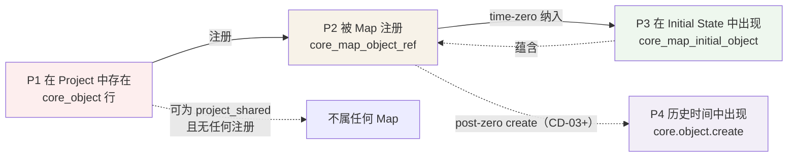
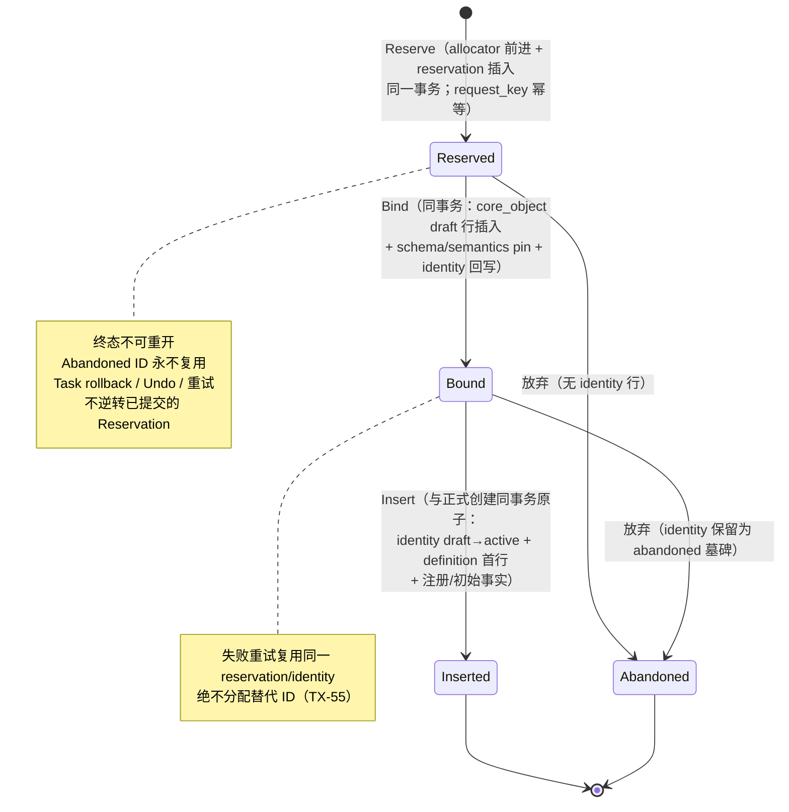
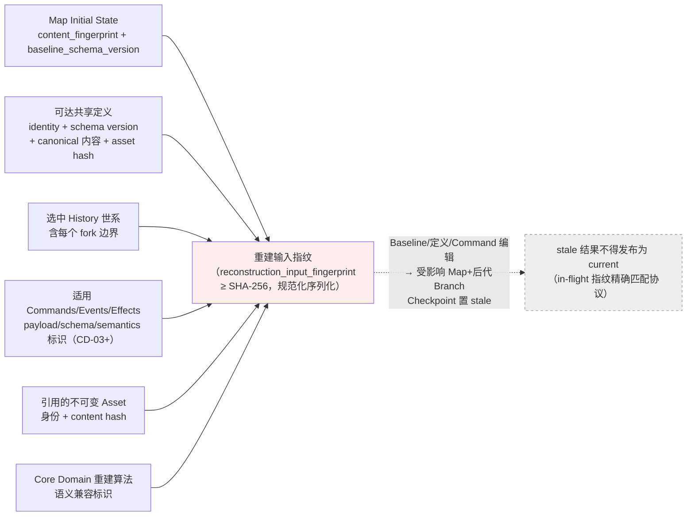

# CD-02-A — Object Authority Model（领域关系图）V0.1

- **Date:** 2026-11-22
- **Status:** Architecture closure 附属图集 — 表达 ownership / reference / membership / temporal 关系；与[主文档](CD-02-A_OBJECT_AND_INITIAL_STATE_AUTHORITY_v0.1.md) §4–§14 对应
- **图例约定：** 实线箭头 = ownership/组合（拥有方→被拥有方）；虚线箭头 = reference（引用）；点线 = membership/解析（time-zero 或世系）；`(--)` 标注为时间性/解析性关系而非持久化行

---

## 1. 权威总览：五层分离与四层存在

```mermaid
graph TB
    subgraph L1["① Object Type 定义数据（编译期 registry）"]
        REG["Descriptor Registry<br/>P2-09-26 V0.2 现行目录<br/>（V2 = P2-09-45，未激活）"]
    end

    subgraph L2["② Object Identity（core_object）"]
        OBJ["Object Identity<br/>object_identity_id (UUID)<br/>allocated_id_value<br/>sharing_scope / owner_map_id<br/>lifecycle: draft/active/abandoned/retired<br/>schema_version + semantics_id 钉住"]
    end

    subgraph L3["③ Project 共享当前定义"]
        DEF["core_object_definition<br/>每 identity 至多一行<br/>definition_payload_json + hash<br/>retroactive current-definition"]
    end

    subgraph L4["④ Map Initial State"]
        IS["core_map_initial_state<br/>每 Map 恰一行<br/>baseline_schema_version + content_fingerprint"]
        ISO["core_map_initial_object<br/>time-zero 成员 + placement"]
    end

    subgraph L5["⑤ Map/Branch 运行时状态（CD-03+）"]
        CMD["core_command 路径<br/>core.object.create / deactivate / activate<br/>（本阶段不实现）"]
    end

    REG -- "descriptor 声明<br/>definition/runtime/initial-state schema" --> OBJ
    OBJ == "1:1 绑定" ==> DEF
    OBJ -. "注册 (core_map_object_ref)" --> MAP
    ISO -. "成员（须有对应注册行）" --> IS
    OBJ -. "time-zero 成员" --> ISO
    CMD -. "post-zero 在场（P4，未来）" --> OBJ

    style L1 fill:#e8eef7,stroke:#8899bb
    style L2 fill:#fdeeee,stroke:#bb8888
    style L3 fill:#eef7ee,stroke:#88bb88
    style L4 fill:#f7f2e8,stroke:#bbbb88
    style L5 fill:#f2eef7,stroke:#9988bb
```

**存在四层（不得合并为单一 Status）：**



## 2. Project / Map / History / Branch 与 Initial State

```mermaid
graph TB
    PRJ["core_project<br/>（一库一项目）"]

    PRJ ==>|"1:N"| TYP["core_object_type<br/>十内置类型播种<br/>type_key / allocatable / 分配格式"]
    PRJ ==>|"1:N"| MAP["core_map"]
    PRJ ==>|"1:N"| OBJ["core_object<br/>sharing_scope=project_shared<br/>owner_map_id=NULL"]

    MAP ==>"恰好一行根历史"| HR["core_history<br/>kind=map_root"]
    MAP ==>|"1:1"| IS["core_map_initial_state<br/>唯一权威 time-zero 基线"]
    MAP ==>|"0:N"| REF["core_map_object_ref<br/>Map 显式注册"]

    HR ==>|"fork（闭区间 ≤ parent_at）"| BR["core_branch<br/>parent_at 边界"]
    BR ==>"同事务创建自有历史"| HB["core_history<br/>kind=branch_owned"]
    HB ==>"fork"| BR2["core_branch（后代）"]

    IS ==>|"1:N 成员"| ISO["core_map_initial_object<br/>membership + placement"]
    REF -.->|"须有对应注册行"| ISO

    TYP ==>|"allocation namespace<br/>Project + Type"| ALLOC["core_object_id_allocator<br/>next_sequence"]
    ALLOC ==>|"同事务前进"| RES["core_object_id_reservation<br/>Reserved/Bound/Inserted/Abandoned"]
    RES ==>"bind（identity 回写）"| OBJ

    IS -.->|"Branch 继承基线<br/>不复制、无第二 time-zero"| BR
    DEF -.->|"共享定义编辑<br/>retroactive 影响全部引用 Map<br/>及其后代 Branch"| MAP

    style PRJ fill:#e8eef7
    style IS fill:#f7f2e8,stroke:#c0a030,stroke-width:2px
    style ISO fill:#f7f2e8
    style RES fill:#fdeeee
```

要点：
- Initial State 挂 **Map**（不是挂 root History）；Branch 经世系解析到达 root Map 继承同一基线（解析时语义，非写入时复制）。
- `core_map_object_ref` 是注册（P2），`core_map_initial_object` 是 time-zero 成员（P3）：注册而不在 Initial State = 合法（对象后续经 post-zero Command 出现）。
- `core_history` 不回指 `core_branch`（CD-01 结构，保持不变）；Branch 继承边界为闭区间 `effective_time ≤ parent_at`，自身变更严格 `> parent_at`（ADR-005）。

## 3. ID Reservation 状态机



## 4. Object / Definition / Geometry / Asset 所有权

```mermaid
graph TB
    OBJ["core_object<br/>（顶层语义 Object）"]

    subgraph DEFCTX["③ 当前定义（Project 共享 / map-local）"]
        DEFP["core_object_definition<br/>definition_payload_json"]
        DEFG["Geometry Component manifest<br/>（typed metadata，10 规范字段：<br/>geometry_component_id / role / family /<br/>dimension / spatial_reference /<br/>schema_version / asset_id / content_hash /<br/>provenance / validity）"]
        DEFP == "包含" ==> DEFG
    end

    subgraph ISCTX["④ Map Initial State"]
        ISP["core_map_initial_object<br/>initial_membership_payload_json"]
        ISG["time-zero geometry manifest<br/>（若该类型 Initial State 携带）"]
        ISP == "包含" ==> ISG
    end

    subgraph CMDCTX["⑤ Command payload（CD-03+）"]
        CMDG["post-zero 几何变更<br/>core.geometry.adjust/refine/add/remove"]
    end

    ASSET["不可变 Core Asset 字节<br/>FileAssetStore（SHA-256 内容寻址）<br/>core_asset 权威记录（后续阶段建表）"]

    OBJ ==>"拥有"==> DEFCTX
    OBJ -.->|"经 core_map_object_ref + initial_object"| ISCTX
    OBJ -.->|"post-zero"| CMDCTX

    DEFG -.->|"core_object_definition_asset<br/>（条件性，CD-02-B 不建）<br/>owner keys + asset_id + role<br/>不含 hash/component id"| ASSET
    ISG -.->|"core_map_initial_object_asset<br/>（不启用，revisit 条件见主文档 §17.3）"| ASSET
    CMDG -.->|"core_command_asset<br/>（Command 阶段必需）"| ASSET

    style OBJ fill:#fdeeee
    style ASSET fill:#eef7ee
    style DEFCTX fill:#eef7ee,stroke:#88bb88
    style ISCTX fill:#f7f2e8,stroke:#bbbb88
    style CMDCTX fill:#f2eef7,stroke:#9988bb
```

要点：
- Geometry Component identity 属于顶层 Object，**无组件表**——组件身份/role 存于 owner typed payload（definition / Initial State / Command 三处之一，恰好一个权威位置）；payload 与 typed link 必须一致。
- 每组件一个不可变 Asset（推荐粒度）；in-place 编辑发布新 Asset，组件 ID 不变；Asset 字节被正式引用期间永不删除/覆写。
- 发布序列：先字节（staging→hash→原子发布）→ 后 DB 短事务写 link；"file existence never implies successful publication"。

## 5. 重建输入与 Checkpoint 感知（指纹组成契约）



不含：`created_at`/`updated_at`/审计文本/UI 元数据；禁止用 revision/version 表替代内容身份（P2-09-16 §4/§8）。

## 6. Mermaid 图结构验证记录

- 6 幅图（2 幅总览 graph + 1 幅 Project/Map/History graph + 1 幅 `stateDiagram-v2` + 2 幅 ownership/指纹 graph）均为 `graph`/`stateDiagram-v2` 声明 + 节点/边语法；子图标题含中文与括号，已用引号包裹避免解析歧义；`==>`/`-->`/`-.->` 三种边型与 `style` 指令为 GitHub Mermaid 支持子集。
- `stateDiagram-v2` 的 transition label 含 `<br/>` 与括号，均置于 `:` 后单行内，无裸冒号嵌套。
- 经脚本核对（2026-11-22）：围栏配对完整（6 对）、全部 graph 子图 subgraph/end 平衡、花括号配对无残缺（见主文档 §22）。
