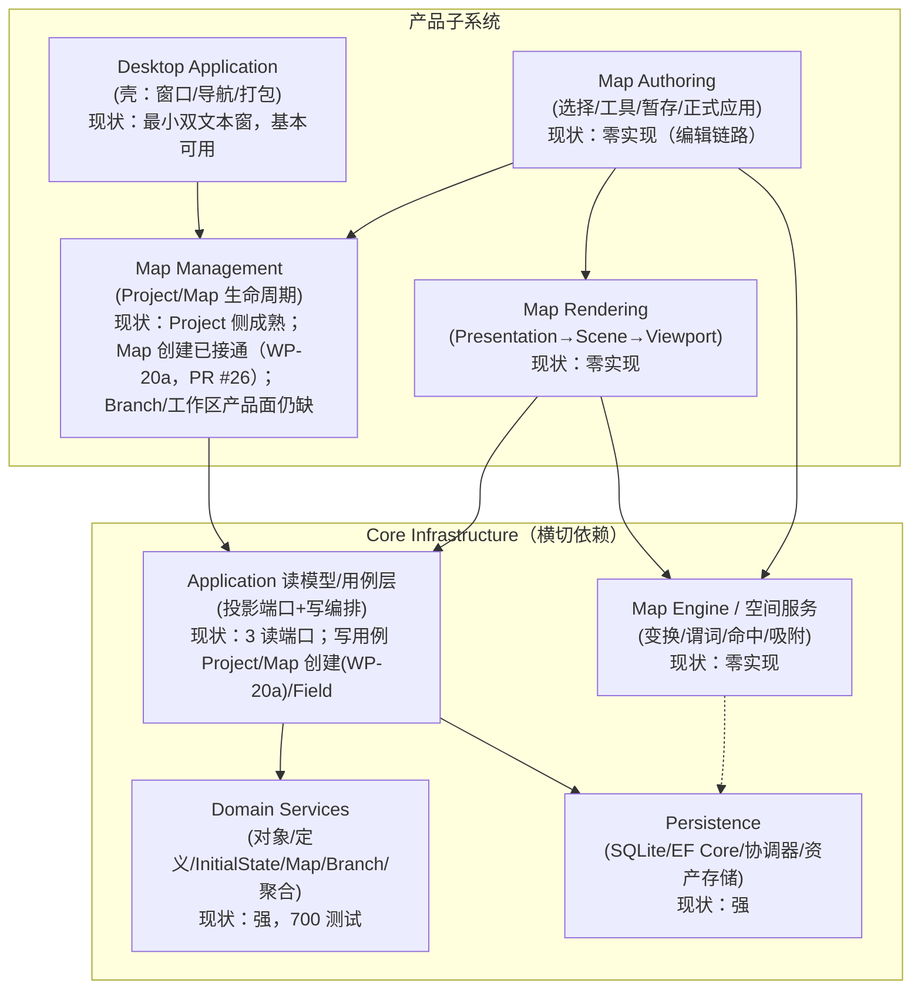
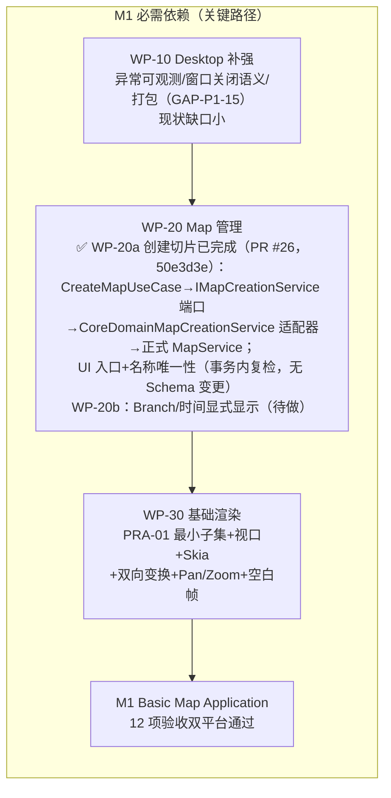
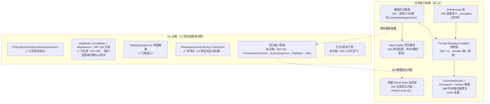

# Implementation Dependency Graph

依据 `docs/map-editor/implementation-roadmap-v1.md` 的五子系统划分与 WP-10/20/30→M1 序列，结合本次审计的实际代码状态绘制。**箭头方向 = 依赖方向（A → B 表示 A 需要 B 先就绪）。**

## 1. 顶层依赖图

## 2. M1 关键路径（roadmap WP-10 → WP-20 → WP-30）

**关键判断**：

- ~~WP-20a（Map 创建切片）~~ **已完成**（2026-11-24，PR #26，`50e3d3e`）：四层全链按原规划依赖方向落地，`MapRules.CreateMap`/`MapService`/SQLite 写入/端到端测试全部复用，名称唯一性在创建事务内复检（无 Schema/Migration 变更）；测试 700→728 全绿。GAP-P0-2 已解除。**M1 剩余关键路径首位为 WP-30**。
- WP-30 **是唯一从 0 开始的 M1 组件**（21 项渲染能力零实现），但其设计契约已冻结（PRA-01/PRODUCTION_RENDERER_ARCHITECTURE v0.2），且 M1 只需"空白但真实"的最小子集——**不需要** Map Engine 的空间谓词/测量/布尔运算（Pan/Zoom 只需仿射变换与视口状态）。
- M1 **不需要** Authoring 的任何部分，也不需要 Relationship/Command/Checkpoint/History 重建（它们是 M3/M4 的地基）。

## 3. 分层细节：M1 必需 vs 未来能力依赖

## 4. 依赖方向铁律（审计确认的现状边界，实施时不得破坏）

| 边界 | 现状证据 | 实施约束 |
|---|---|---|
| Desktop 不直连 SQLite/文件 | 唯一 Infrastructure using 在组合根 `Program.cs:11-17` | 新 UI 一律经 Application 端口/用例 |
| Renderer 只读正式状态 | 渲染层不存在（待建）；PRA-01 契约"draw callback 无 DB/无 mutation" | WP-30 实施时视口回调不得触 Domain 写路径 |
| Editor 正式操作必须经 Domain 写服务 | `Cd02MapEditorIntegrationTests` 头注释"无 UI 直写 SQLite" | WP-50 不得绕过用例层开端口 |
| 渲染/制作两子系统分离 | roadmap v1 §1 | 空白视口是渲染里程碑不是制作里程碑 |

## 5. 推荐实施顺序（与 roadmap 一致，附本次审计修正；2026-11-24 更新）

1. ~~WP-20a Map 创建切片~~ **已完成**（PR #26，`50e3d3e`）：`IMapCreationService` 端口（Application）+ `CoreDomainMapCreationService` 适配器（Infrastructure，复用 `CoreDomainMapQueryService` 的会话绑定模式）+ `CreateMapUseCase`（只依赖 Application 抽象）+ ProjectWindow 创建入口 + Map 名称唯一性规则（Domain 最小修改，正式写路径保障）+ 28 项测试（Domain/Application/Infrastructure 真实 SQLite/Desktop ViewModel）。
2. **WP-30 渲染切片**（最大单项，当前关键路径首位；建议先出两页技术决策：自绘控件 vs CustomDrawOperation；PRA-01 最小子集清单）。
3. **WP-10 并行小项**：异常钩子接日志；窗口关闭语义；RecentProjectsStore 测试；打包发布链（GAP-P1-15，`dotnet publish` 产物 + 验证流程）。
4. **WP-20b**：Branch/时间显式显示与选择 UI、最近 Map 偏好（roadmap WP-20 exit criteria）。
5. **平台门收尾**：macOS GUI 冒烟清单执行（GAP-P0-4）+ Windows 全流程冒烟 → M1 验收记录（发布产物属 WP-10 的 GAP-P1-15，非 M1 独立门）。
