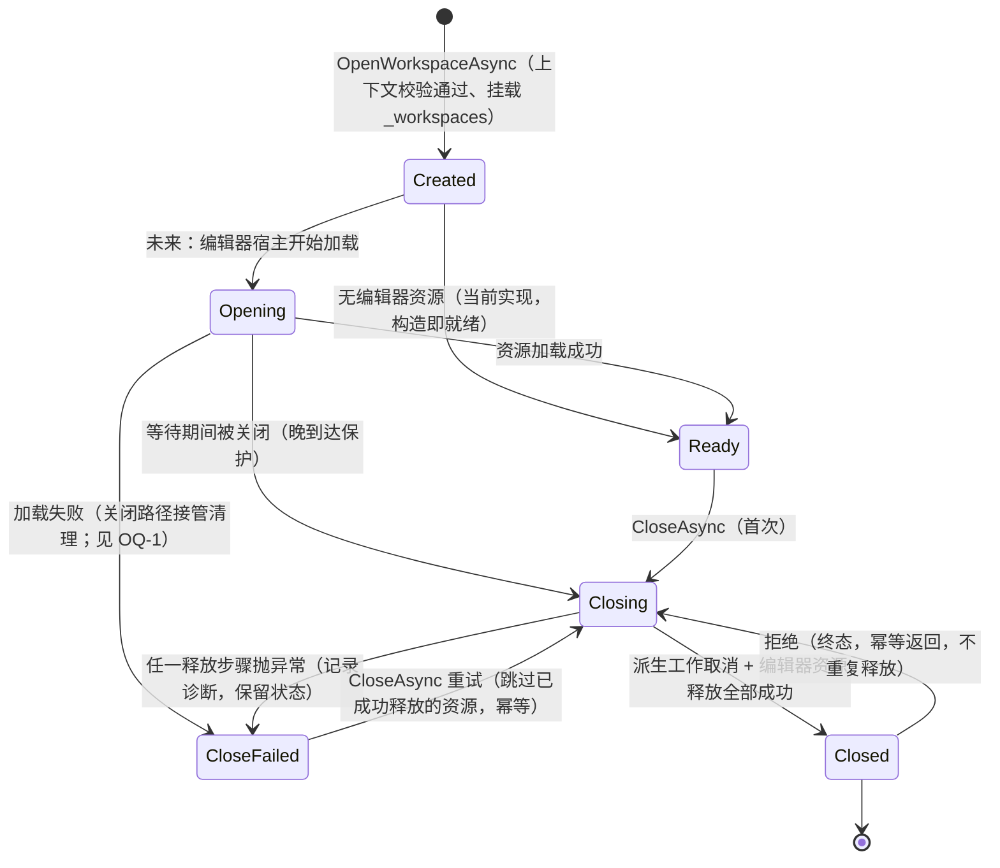

# WP-UI-04A：Map Workspace 生命周期状态机

基线：master `8bdbad1906f7b0c5f3d573b65fc1076867452943`。
项目级状态机（`ProjectSessionState`）已在 PR #34 落盘
（`WorldView/docs/architecture/project-session-close-lifecycle.md`），本文不重复，
只定义 **MapWorkspaceSession 的状态机**及两级一致性约束。

## 1. MapWorkspaceSession 状态集

| 状态 | 语义 | 进入条件 |
| --- | --- | --- |
| `Created` | 对象已构造，上下文已校验，编辑器宿主未加载 | `OpenWorkspaceAsync` 内 `new MapWorkspaceSession(...)` |
| `Opening` | 编辑器宿主/地图工作资源加载中（**当前阶段不使用，为 Editor 预留**；无 Editor 时构造后直接 Ready） | `ReadyAsync`/宿主加载启动（未来） |
| `Ready` | 可正常使用；允许 SwitchContext、允许关闭 | 资源就绪（当前实现：构造即 Ready） |
| `Closing` | 关闭执行中：派生工作已取消、编辑器资源释放中 | `CloseAsync` 首次调用 |
| `CloseFailed` | 关闭中发生异常：资源可能部分释放；保留完整状态供重试 | `CloseAsync` 抛出异常 |
| `Closed` | 全部资源释放成功；终态 | 全部释放步骤成功 |

当前实现（`MapWorkspaceSession.cs` L16-19）只有 `_closed`/`_disposed` 两个布尔，
行为上等价于 `Ready → Closing → Closed` 直通路径且永不失败。WP-UI-04B（R1）将其
替换为显式枚举，语义不变、增加失败重试能力，为 Editor 资源释放失败预留位置。

## 2. 状态转换图



说明：

- `Created → Ready` 当前是同步的：`OpenWorkspaceAsync` 在构造前已完成地图存在性检查与
  Branch/历史时间解析（`ProjectSession.cs` L165-177），Session 诞生即携带
  `ValidatedWorkspaceContext`。`Opening` 状态本阶段**定义但不进入**（禁止事项：不过早实现）。
- `Closed` 对任何再次关闭调用幂等返回（对齐 `ProjectSession.CloseAsync` L224-228 语义）。
- `CloseFailed` 的唯一出口是重试（`CloseAsync` / `DisposeAsync` 再调用），回到 `Closing`
  并从失败点继续——依赖每步释放的幂等性（§3）。

## 3. 各状态允许的操作

| 操作 | Created | Ready | Closing | CloseFailed | Closed |
| --- | --- | --- | --- | --- | --- |
| `SwitchContextAsync` | ⛔ | ✅（成功后取消旧派生工作） | ⛔（晚到达丢弃结果） | ⛔ | ⛔ |
| `CloseAsync` | ✅（跳过 Opening 语义直接关闭） | ✅ | ⛔ 幂等返回（已有一次关闭在执行） | ✅ 重试入口 | ✅ 幂等返回（不重复发事件） |
| `DisposeAsync` | ⛔ | ⛔（必须先 CloseAsync） | （由 CloseAsync 流程驱动） | ✅ 继续释放剩余资源 | ✅ 幂等返回 |
| 新编辑器挂载（未来） | ✅（Opening 期间） | ✅（热加载，另行决策） | ⛔ | ⛔ | ⛔ |

异常与取消行为：

- `CloseAsync` 的取消语义（WP-UI-04B R1 P2-01 修订）：`cancellationToken` 只作用于
  **关闭流程开始前**——进入 `Closing` 之前已取消，以 `OperationCanceledException` 结束，
  状态不变、不执行任何释放、**不进入 `CloseFailed`**；一旦进入 `Closing`，释放按固定
  顺序执行到底，不再接受取消——调用方在 `Closing` 阶段取消令牌不会导致资源只释放一半，
  也不会触发 `CloseFailed`。不允许通过吞掉异常实现取消。
- 重复 `CloseAsync` 并发调用：`Closing` 幂等短路（单机桌面程序无并发关闭入口，
  对齐 `ProjectSession.cs` L224 注释的既有裁定）。

## 4. 资源释放顺序（Session 级）与"成功后才移除"原则

固定顺序（单 Session 内）：

```
① 派生工作取消（_derivedWorkCts.Cancel —— 通知 Editor/后台工作停止）
② 编辑器资源释放（未来；当前无）
③ 派生工作取消源释放（_derivedWorkCts.Dispose）
```

每步**成功后**才置位对应"已释放"标记；重试时跳过已标记步骤。
Session 级别的资源**没有**独立于 Close 流程的第二释放入口——
`DisposeAsync` 只是 `CloseAsync` 的续段（对齐 `ProjectSession.DisposeAsync` L318 的既有模式）。

**注册移除规则（本阶段最关键的不变量）**：

> `ProjectSession.CloseWorkspaceAsync` / `ProjectSession.CloseAsync` 必须在该子工作区
> `CloseAsync` **且** `DisposeAsync` 都成功返回后，才把它从 `_workspaces` 移除。
> 任何失败 → 工作区保留在列表中 → 状态 `CloseFailed` → 可重试。

- 现状缺陷：单关路径 `ProjectSession.CloseWorkspaceAsync`（L194-213）只 Close + Remove，
  Dispose 散落在 ViewModel（`ProjectWorkspaceViewModel.cs` L144）——属于"先移除、
  他人补释放"，违反本不变量。WP-UI-04B（R3）修复。
- 项目级路径已符合：`ProjectSession.CloseAsync` L237-259（双成功才 RemoveAt，失败保留
  在列表，重试幂等）——本阶段**不改**，仅新增状态机语义。
- UI 镜像规则：`ProjectWorkspaceViewModel.Workspaces` 集合只在 Session 列表移除成功的
  **结果返回后**同步移除（R4）；禁止"先删 UI 再试释放"。

## 5. Session 与 Window 的一致性

不变量（按优先级）：

1. **每个存活的 MapWorkspaceWindow 必须恰好对应一个 `_workspaces` 中的活动 Session**；
   反之不要求（Session 可暂无窗口——04B 阶段、或窗口创建失败的瞬间）。
2. **窗口销毁 ⇒ Session 已释放**：窗口 `Closing` 拦截 → 驱动
   `ProjectSession.CloseWorkspaceAsync` → 只有成功返回才允许真关闭（详见
   `window-management.md` §3）。
3. **Session 被项目级关闭释放 ⇒ 窗口随后销毁**：VM 订阅 Session 关闭结果，驱动
   `_allowClose → Close()`（被动跟随，见 `architecture.md` §6）。
4. **窗口注册表与 Session 列表不分叉**：注册表以窗口 `Closed` 事件自清理；任何时刻
   断言 `registry.Count == 活跃地图窗口数` 且每个 handle 的 Session 可在所属
   `ProjectSession.Workspaces` 中找到（验收项，见 `acceptance-criteria.md` §A-13）。
5. **重复关闭幂等**：窗口层 `_closeInProgress` 防重入（沿用 ProjectWindow L27-30 模式），
   Session 层状态机幂等——两层各自幂等，组合仍幂等。

## 6. 项目级一致性（引用既有结论，不改设计）

`ProjectSessionState` 状态机、`SessionClosed` 单次触发、Registry 成功才解除占用、
`CloseAllAsync` 仅 `Closed` 才 `Remove`——全部沿用 PR #34 设计文档
（`WorldView/docs/architecture/project-session-close-lifecycle.md` §2-§3）。
本阶段唯一新增约束：**`Closed` 前提除"子工作区全部成功释放"外，隐含"对应窗口全部
销毁"**——由不变量 2/3 推导（Session 全部释放 ⇒ VM 全部收到关闭结果 ⇒ 窗口全部关闭），
无需项目层感知窗口。

## 7. WP-UI-04B 实现记录（与设计的差异及最终结构）

基线：master `7b03057`（merge PR #35）。本节为 04B 落盘后的实际实现记录，优先于上文描述。

### 7.1 状态集与命名

- 枚举名定为 **`MapWorkspaceState`**（04A 实施计划曾写作 `MapWorkspaceLifecycle`）——
  对齐既有 `ProjectSessionState` 命名约定。状态集 `Created/Opening/Ready/Closing/CloseFailed/Closed`
  与 §1 完全一致。
- **Created 可观察**：构造函数置 `Created`；`ProjectSession.OpenWorkspaceAsync` 挂载
  `_workspaces` 后调用内部 `MarkReady()` 进入 `Ready`（OQ-7 的"构造即就绪"语义不变，
  但保留了 Created 状态的可测试窗口）。`Opening` 定义但不进入（不过早实现）。

### 7.2 关闭与释放的最终结构（B4/G3 修复）

- `MapWorkspaceSession` 以 `_closeCompleted` / `_disposeCompleted` 两个独立完成标记
  记录释放进度（替换原 `_closed`/`_disposed` 布尔）。`CloseAsync` 驱动固定顺序
  ① 派生工作取消 → ② 编辑器资源释放（未来）→ ③ 会话资源释放（CTS Dispose），
  每步成功才置位；任一步异常 → `CloseFailed` + `CloseFailureDiagnostic`，进度保留。
- **"Close 成功、Dispose 失败"是可表达、可重试的一等状态**：重试（`CloseAsync` 或
  `DisposeAsync`）跳过已置位步骤，仅执行剩余步骤，不重复执行已成功的关闭。
- `DisposeAsync` 为**续段语义**（对齐 `ProjectSession.DisposeAsync` 模式）：
  Closed/Closing 幂等返回；CloseFailed 继续释放剩余资源；**Created/Ready 明确拒绝**
  （"必须先经 CloseAsync"）——释放责任唯一归属关闭流程，VM/Window 不得再直接释放
  （原 VM 自做 `DisposeAsync` 已删除）。**WP-UI-04B R1 P2-02 修订**：本方法收为
  `internal`，类不再实现公开 `IAsyncDisposable`——ProjectSession 是生命周期唯一所有者，
  外部调用者不得绕过 ProjectSession 直接释放工作区 Session（调用方仅 ProjectSession
  与同程序集测试，经 `InternalsVisibleTo`）。
- **注册移除规则已按 §4 不变量落地**：`ProjectSession.CloseWorkspaceAsync` 改为
  Close → Dispose → 双成功才 `_workspaces.Remove`；任意阶段失败返回 `false`、
  Session 保留在列表（CloseFailed）可重试。签名保持 `Task<bool>`（04A 计划曾建议
  `(bool, string?)` 元组）：诊断经 `workspace.CloseFailureDiagnostic` 获取，避免无谓
  API 重构；失败返回 `false` 是窗口关闭时序（window-management.md §3 `PS→VM: false
  + 诊断`）定义的业务分支，非吞异常。
- **B3 去重**：`OpenWorkspaceAsync` 双重检查——早检查（有可复用工作区时跳过地图查询
  与上下文解析）+ 挂载锁内权威复查（晚到达保护内）。Ready 复用既有 Session 并返回；
  Closing/CloseFailed 拒绝（抛出明确异常，不得绕开失败状态另建）；Closed 不复用
  （移除后允许重开为新 Session）。不引入全局 Registry。
- **B2 MapName**：构造函数强制校验（`ArgumentException.ThrowIfNullOrWhiteSpace`）；
  `OpenWorkspaceAsync` 对 `map.DisplayName` 为空抛出明确异常（不静默降级）；
  `MapName` 只来自真实地图数据。
- **测试注入点**：新增 internal `DisposeFailureHookForTests`，在**真实 CTS Dispose 执行前**
  调用，可注入释放失败异常（WP-UI-04B R1 P2-02 修订：原"释放后注入"会造成"资源已释放、
  `_disposeCompleted` 未置位"的假失败——标志与真实资源状态不一致、重试重复执行 Dispose）。
  释放阶段当前只有一个不可再分的真实步骤（CTS Dispose），注入失败即"该步骤未执行"，
  不为形式引入更细的状态机。沿用 `FakeAssetStore.FailureHook` 注入模式——CTS 无自然失败
  路径，此为验证 mandated "Close 成功、Dispose 失败"重试语义的最小接缝，生产代码不设置。
- **`IsClosed` 兼容语义**：Closing/CloseFailed/Closed（对齐替换前 `_closed` 布尔在
  关闭发起即置位的行为）。

### 7.3 ViewModel 消费（B4.9/B4.10）

`ProjectWorkspaceViewModel.CloseWorkspaceAsync`：消费 `CloseWorkspaceAsync` 的 bool 结果，
仅成功才从 `Workspaces` 集合移除；失败保留集合项并写状态文本（含诊断）。
`OpenWorkspaceAsync`：Session 层去重返回既有 Session 时 UI 集合不重复添加（镜像不分叉）。

### 7.4 测试映射

`MapWorkspaceSessionLifecycleTests`（Session 状态机/守卫）、
`ProjectSessionWorkspaceLifecycleTests`（去重/原子关闭/项目级关闭兼容性，
覆盖 A-1/A-2/A-3(Session 部分)/A-6~A-11）、`ProjectWorkspaceViewModelWorkspaceTests`
（A-5 + UI/Session 不分叉）。详见 `acceptance-criteria.md` §A 注记。
