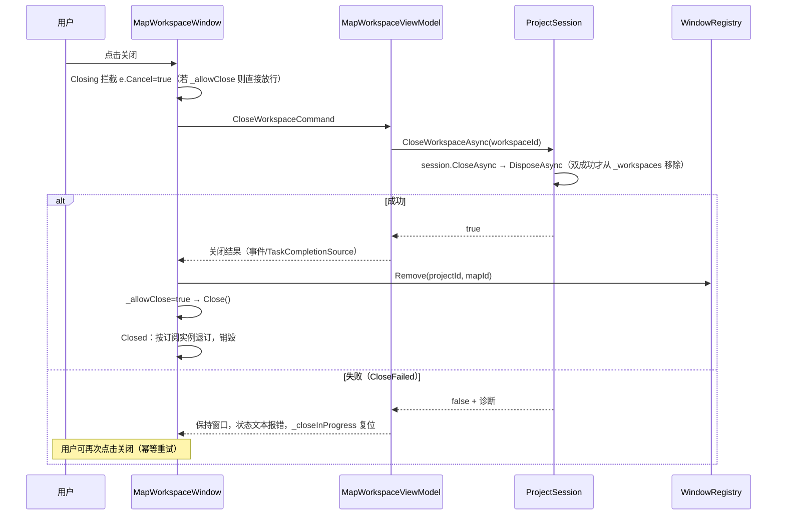
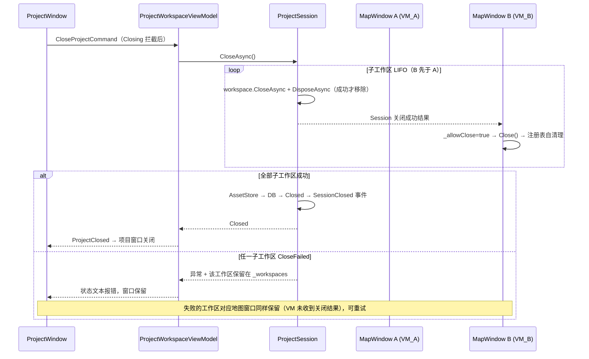

# WP-UI-04A：MapWorkspaceWindow 窗口管理设计

基线：master `8bdbad1906f7b0c5f3d573b65fc1076867452943`。
原则：不引入全局窗口管理框架；窗口管理 = 一个轻量注册表 + 既有的"VM 发起、
事件确认"模式（PR #34 已在项目窗口上验证）。

## 1. 组件与职责

| 组件 | 层 | 职责 | 明确不做 |
| --- | --- | --- | --- |
| `MapWorkspaceWindowRegistry` | Desktop（组合根单例） | 以 `(Guid projectId, Guid mapId)` 为键登记/查找/激活/移除窗口句柄；提供 `Count` 供诊断 | 不创建窗口、不调用 Session 方法、不持有 Session 生命周期 |
| `MapWorkspaceWindowHandle` | Desktop | `{ ProjectId, MapId, Window, ViewModel }` 值记录 | — |
| `MapWorkspaceWindow` | Desktop (View) | UI 呈现；`Closing` 拦截 → 驱动关闭命令；`Closed` → 退订事件 + 通知注册表 | 不直接调用 Session/Dispose |
| `MapWorkspaceViewModel` | Desktop (VM) | 标题/状态/错误文本；`CloseWorkspaceCommand`（经 `ProjectSession.CloseWorkspaceAsync`）；订阅 Session 关闭结果 | 不持有资源、不做 UI 操作 |
| `ProjectSession` | Application | Session 创建、同图去重、关闭执行（Close+Dispose+移除原子化） | 不知道窗口存在 |

依赖方向：`Window → ViewModel → ProjectSession → MapWorkspaceSession`，单向。
注册表被 View 层（窗口打开入口）与窗口 `Closed` 清理使用，不被 Application 层引用。

## 2. 十个必答问题

**1. 谁负责创建窗口？**
`ProjectWorkspaceViewModel.OpenWorkspaceCommand`（地图打开入口）——它已有会话绑定上下文
（`ProjectSession`、`IMapQueryService`）。流程：① 查注册表去重/激活；② 未命中 →
`Session.OpenWorkspaceAsync`；③ 经组合根工厂创建 VM；④ `new MapWorkspaceWindow` 登记注册表后 `Show()`。
不放在 `StartWindow`（它与地图无关），不放 `App`（组合根只装配不驱动流程）。

**2. 谁持有窗口引用？**
唯一持有者是 `MapWorkspaceWindowRegistry`（强引用句柄）。创建入口不保留字段引用
（纠正 `StartWindow._workspaceWindow` 字段式持有在多窗口下不可扩展的问题）；
Avalonia 自身的窗口树不算持有者语义。

**3. 谁持有 MapWorkspaceSession？**
`ProjectSession._workspaces`（唯一所有者，既有不变）。窗口/VM/注册表只通过
`ProjectSession.Workspaces` 快照或事件消费，不另存"权威"引用（VM 内的 Session 引用是
只读句柄，用于状态文本与关闭命令参数，所有权仍在项目）。

**4. 窗口与 Session 如何关联？**
静态关联：VM 构造时注入 `MapWorkspaceSession` + 所属 `ProjectSession`；
键 `(Session.ProjectSession.ProjectId, Session.Context.MapId)` 即注册表键。
动态确认：窗口关闭必须以 `ProjectSession.CloseWorkspaceAsync(workspaceId)` 返回成功为唯一凭证。

**5. 如何保证同一地图只有一个窗口？**
两层去重：
- **入口去重（主）**：打开命令先查 `registry.Find(projectId, mapId)`，命中且窗口存活
  （`Window.IsVisible` 或非 `Closed`）→ `Activate()` 并返回，**不调用 `OpenWorkspaceAsync`**
  （满足"不重复创建 MapWorkspaceSession、不重复加载资源"）。
- **Session 去重（兜底）**：`ProjectSession.OpenWorkspaceAsync` 在挂载前检查 `_workspaces`
  是否已有同 `Context.MapId` 的活动工作区（04B R2），存在则返回既有 Session。
  入口与 Session 层在同一 UI 线程串行执行，竞态窗口极小，兜底保证不变量成立。

**6. 如何激活已有窗口？**
`existing.Window.Activate()`（Avalonia 前置 + 焦点）。窗口若被最小化，`Activate` 的
平台行为差异（Windows 恢复、macOS 可能不还原最小化）在 04D 人工验收中确认，
必要时补 `WindowState = Normal`（见 `acceptance-criteria.md` §M-3）。

**7. 如何处理窗口创建失败？**
窗口构造/show 抛异常（罕见：平台资源耗尽）：catch → 状态文本报错 → **从注册表移除该句柄
（若已登记）→ 回滚：`ProjectSession.CloseWorkspaceAsync` 释放刚创建的 Session** →
不留孤儿 Session。顺序：先释放 Session（其已注册于 `_workspaces`）→ 再清登记 → 再报错。

**8. 如何处理窗口关闭失败？**
`CloseWorkspaceAsync` 失败（Session `CloseFailed`）：`e.Cancel = true` 保持窗口，
状态栏显示"关闭工作区失败：{诊断}"，`_closeInProgress` 在 finally 复位（沿用
ProjectWindow L39-53 模式）→ 用户可再次点击关闭（幂等重试）。窗口在关闭失败期间
进入只读提示态（禁用打开类入口，不再新增派生工作）。

**9. 如何避免窗口事件订阅泄漏？**
全部沿用 PR #34 模式：
- VM 订阅 Session/项目事件时记录实例，`DataContext` 更换或窗口 `Closed` 时按**订阅时的
  实例**退订（ProjectWindow L57-85 模式）；
- 注册表订阅窗口 `Closed` → 自移除句柄（`ReferenceEquals` 校验防陈旧句柄）；
- `ProjectSession.SessionClosed`（项目级）由 `ProjectSessionRegistry` 订阅，地图 VM 不重复订阅；
  地图 VM 只订阅自己 Session 的关闭结果回调。
每条退订路径在 `acceptance-criteria.md` §A-12 有对应自动化断言（事件触发计数归零）。

**10. 项目关闭时如何统一关闭所有子窗口？**
窗口被动跟随（`architecture.md` §6）：`ProjectSession.CloseAsync` LIFO 释放子工作区 →
每个 `MapWorkspaceViewModel` 收到自己 Session 的关闭成功结果 → 驱动窗口
`_allowClose = true; Close()`。任何子工作区 `CloseFailed` → 对应窗口保留 → 项目
`CloseFailed` → 项目窗口保留重试。项目层全程不感知窗口对象。

## 3. 窗口关闭时序（单窗口，用户点标题栏 X）

窗口 `Closed` 之后**不得**再被激活：注册表已移除句柄，入口去重查不到；
即使外部持有陈旧引用调用 `Activate`，Session 已 `Closed`，VM 状态文本显示
"工作区已关闭"且关闭命令幂等返回——不产生任何资源副作用。

## 4. 项目关闭时序（多窗口联动）

## 5. 多项目并存

- 不同项目的 `ProjectWindow` 并存由既有机制保证（`ProjectSessionRegistry` 路径占用 +
  `StartWindow` 项目窗口去重 `IsVisible` 检查）。
- 地图窗口键含 ProjectId → 项目 A 的"世界总览"与项目 B 的"世界总览"是两个独立句柄，
  互不命中去重。
- 项目关闭只级联**自己**的地图窗口（`ProjectSession._workspaces` 天然按项目隔离）。

## 6. 明确不引入的东西

- 全局 WindowManager/MDI 框架、窗口 Tab 容器：单机场景窗口数个位数，注册表 + Activate 足够。
- 弱引用/句柄池：`Closed` 事件自清理已消除泄漏面，弱引用增加调试复杂度无收益。
- 跨窗口消息总线：VM→Window 用单一关闭结果回调（`Task`/事件）即可。
